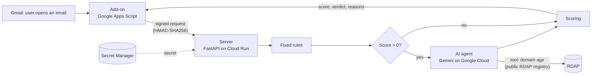

# Malicious Email Scorer - Gmail Add-on

A Gmail add-on that checks the email you open and shows a **score from 0 to 100**, a **verdict** (Safe, Suspicious or Likely malicious), and the **reasons** behind it.

It works in two layers:

1. **Fixed rules** decide the score. The same email always gets the same score (the rules are *deterministic*).
2. **An AI agent** runs after the rules. It decides what else to check, explains the result in plain language, and recommends what to do. It does not decide the score.

---

## How it works



The add-on is kept small on purpose: it collects the email details, sends them to the server, and shows the result. All checks run on the server, which is written in Python, covered by 33 automated tests, and the only place where secrets are kept.

The panel shows the verdict, the score, the sender split into **display name** and **real address** (so impersonation is easy to spot), and every finding with its points and a short explanation.

**Code:** `addon/` contains the Gmail add-on, `backend/app/analyzers/` the fixed rules, `backend/app/agent.py` the AI agent, and `backend/app/scoring.py` the scoring.

---

## What it checks

| Check | What it looks for | Points |
|---|---|---|
| Authentication | DMARC failed. | +30 |
| | SPF failed or soft-failed. | +20 / +10 |
| | DKIM failed. | +15 |
| | Gmail's authentication result is missing. | +10 |
| Sender | The display name contains an address from another domain, such as `"support@paypal.com" <x@evil.example>`. | +25 |
| | Replies go to a different organization than the sender. | +15 |
| Links | The link text shows one website, but the link leads to another. | +25 each, up to 3 |

A score below 25 is **Safe**, 25 to 59 is **Suspicious**, and 60 or more is **Likely malicious**.

A few decisions behind these rules:

- **Only Gmail's own authentication result is trusted.** An attacker can add a fake header that claims "DMARC passed", so the add-on reads only the one Gmail adds.
- **Website names are read from right to left.** In `paypal.com.secure-login.ru`, the real owner is `secure-login.ru`.
- **Links like "Click here" are not flagged.** Almost every normal email has them, and a tool that warns about everything gets ignored.

### The AI agent

The agent runs only when the rules have already found something, which saves money and waiting time on normal emails. It receives the findings, the sender's domain and the subject, but not the body of the email.

It has one tool: it can look up when a domain was registered. It decides on its own whether to use it and for which domain. For example, it checks `secure-login.ru` and skips `paypal.com`, which is well known.

**The AI decides what to check, and the code decides how much it is worth.** Points are added only by two fixed rules:

- If the agent finds a domain registered less than 30 days ago, the code adds 20 points.
- If the agent recommends "don't click" or "report to security", the verdict is raised to at least **Suspicious**, but never higher. This works only in the safe direction: if an attacker manages to influence the agent, the worst result is a false alarm on their own email, never a hidden threat.

### Why both rules and AI

| | Fixed rules | AI agent |
|---|---|---|
| Same email, same result | Yes | No |
| Cost and waiting time | Almost none | Costs money, takes a few seconds |
| Can be tricked by text in the email | No | Yes (prompt injection) |
| Can notice things no rule was written for | No | Partly |
| Explains in plain language | Only fixed text | Yes |

Each side is strong where the other is weak, so the rules decide the score, and the AI investigates and explains within limits set in the code.

Domain age could also have been a fixed rule. I let the agent choose what to check because registry lookups are slow and limited, and because the design is ready for more tools (such as website reputation), when running every check on every email is no longer practical.

---

## Security

Everything from outside is treated as untrusted: the email, the server's answer, and the AI's answer.

| Risk | How it is handled |
|---|---|
| Someone else uses the server | Every request is signed with a shared secret (HMAC-SHA256). Without a valid signature, the server answers `401`. Requests older than 5 minutes are rejected. |
| Email data goes somewhere else | The add-on can contact only the server's address (`urlFetchWhitelist`). |
| Secrets leak | There are no secrets in the repository. The secret is in Google Secret Manager, and the AI uses the server's Google Cloud identity instead of an API key. |
| Too many permissions | The add-on reads only the open email. The server can only read one secret and use AI models, and it does not run as root. |
| Bad or huge requests | The server checks size, then signature, then format, before doing any real work. |
| Text in the email acts like code | All text in the panel is escaped. During development, the sender's address disappeared because `<address>` was read as an HTML command. An attacker could use the same weakness to show a fake "This email is safe". |
| Dangerous links | The server never opens links from emails. |
| The AI is tricked | It never sees the email body, can look up only domains from the email, and has limits on steps and time. It can only raise the verdict, up to Suspicious. If it fails, the rules' result is used. Each limit has a test. |

---

## Known limitations

- **Scams without links or fake senders are not caught.** For example: *"Hi, it's Danny from accounting. Please transfer 40,000 to this new supplier today. It's urgent."* The email passes authentication and has no links, so the rules give it 0, and the agent never runs. Catching this needs an understanding of the content, not only of links and headers.
- **Emails you send to yourself get 10 extra points**, because they never pass through Gmail's inbound checks. Skipping the check when the sender looks like the user would be a mistake: the sender controls the "From" field, and fake emails "from yourself" are a known scam.
- **A captured request could be sent again within 5 minutes.** The signature proves a request is real, not that it is new.
- **Some domain endings, such as `.ru`, cannot be checked for age**, because their registries do not offer lookups.
- **Gmail already blocks very obvious phishing**, so the add-on mostly sees what gets through. That is its purpose: an extra layer that explains its result.

## Future improvements

- **Content check:** a cheap rule that looks for pressure and sensitive requests (urgent payment, bank details, passwords) in Hebrew and English. It would add a few points and, more importantly, wake up the agent, which would then read a short part of the email body to understand the intent. This is safe to add because the agent can only raise the verdict.
- **Emails sent to yourself:** use something only Gmail controls, such as the Sent folder, instead of the "From" field.
- **Repeated requests:** add a one-time number to each request and reject numbers already used.
- **New features:** a "Report to security team" button, website reputation as a second agent tool, sender history, and a check for dangerous attachments.

---

## How to run it

To check the code, you only need the tests (about two minutes). To run the full add-on on your own Gmail, you also need a Google Cloud project.

**Tests**

```bash
cd backend
python3 -m venv .venv
source .venv/bin/activate
pip install -r requirements-dev.txt
pytest
```

The AI agent's tests use a fake model, so they need no internet and cost nothing.

**Server on Cloud Run**

```bash
gcloud services enable run.googleapis.com cloudbuild.googleapis.com \
  artifactregistry.googleapis.com secretmanager.googleapis.com aiplatform.googleapis.com

# A random secret, saved straight into Secret Manager
openssl rand -hex 32 | tr -d '\n' | gcloud secrets create hmac-secret --data-file=-

PROJECT_NUMBER=$(gcloud projects describe $(gcloud config get-value project) --format='value(projectNumber)')
SA="serviceAccount:${PROJECT_NUMBER}-compute@developer.gserviceaccount.com"
gcloud secrets add-iam-policy-binding hmac-secret --member="$SA" --role="roles/secretmanager.secretAccessor"
gcloud projects add-iam-policy-binding $(gcloud config get-value project) --member="$SA" --role="roles/run.builder"
gcloud projects add-iam-policy-binding $(gcloud config get-value project) --member="$SA" --role="roles/aiplatform.user"

cd backend
gcloud run deploy email-scorer --source . --region me-west1 \
  --allow-unauthenticated --max-instances 2 \
  --set-secrets HMAC_SECRET=hmac-secret:latest \
  --set-env-vars AI_ENABLED=true,AI_MODEL=gemini-3.5-flash-lite,GCP_PROJECT=<your-project-id>
```

The AI model's name is a setting, not code, because Google retires old models (one was retired while I built this project).

**Add-on**

1. Create a project at [script.google.com](https://script.google.com) and turn on *Show "appsscript.json" manifest file* in Project Settings.
2. Copy the files from `addon/`, and put your Cloud Run address in `urlFetchWhitelist` in `appsscript.json`.
3. In Script Properties, add `BACKEND_URL` (your Cloud Run address) and `HMAC_SECRET` (from `gcloud secrets versions access latest --secret=hmac-secret`).
4. Choose Deploy, Test deployments, Install, and open an email in Gmail.

---

## How I built this

I used an AI assistant (Claude) to learn the tools involved, such as Apps Script, Cloud Run and Vertex AI, and to help write the code. The design decisions and trade-offs described above, as well as reviewing and testing every part, are my own.
