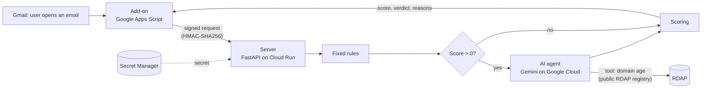

# Malicious Email Scorer - Gmail Add-on

Malicious Email Scorer is a Gmail add-on that checks the email you open and tells you how risky it looks. It shows a score from 0 to 100, a verdict (Safe, Suspicious or Likely malicious), and a clear list of the reasons behind the result.

The tool is built from two layers that work together:

1. **Fixed rules.** These rules decide the score. The same email always gets the same score, which makes the result predictable and easy to test. In technical terms, the rules are *deterministic*.
2. **An AI agent.** The agent runs after the rules. It decides whether anything else is worth checking, explains the result in plain language, and suggests what the user should do. The agent does not decide the score. Points are added only by fixed rules, and only when there is real evidence.

---

## What the user sees

When the user opens an email, a panel on the side of Gmail shows the result.

- The verdict and the score appear at the top of the panel.
- The sender is shown in two parts: the display name and the real email address. The sender can write anything in the display name, so showing the real address next to it makes impersonation easy to spot.
- Every problem that was found is listed with its category, its points, and a one-line explanation.
- When the rules find a problem, the AI agent adds its own explanation, a recommended action, and a note about what it checked.

For example, here is the result for an email with a link that shows `paypal.com` but actually leads to `paypal.com.secure-login.ru`:

| What was found | Points |
|---|---|
| Links: the link shows paypal.com, but it actually leads to paypal.com.secure-login.ru. | +25 |
| AI agent: explains that the link is fake, recommends not clicking it, and reports that it checked `secure-login.ru` in the domain registry. | +0 (no new evidence) |

---

## How it works



The add-on is kept small on purpose. It collects the details of the open email, sends them to the server, and displays the result. All of the checks run on the server, which is written in Python, covered by automated tests, and the only place where secrets are stored.

| File | What it does |
|---|---|
| `addon/Code.gs` | The starting point. It collects the email, sends it for analysis, and shows the result. |
| `addon/Extractor.gs` | Collects only the parts of the email that the server needs, with a size limit on each part. |
| `addon/Client.gs` | Signs the request, sends it to the server, and checks the answer before using it. |
| `addon/Cards.gs` | Builds the panel and makes sure that text from the email is always shown as plain text. |
| `backend/app/main.py` | Receives each request and checks it step by step before running the analysis. |
| `backend/app/analyzers/` | Contains the fixed rules, with one file for each type of check. |
| `backend/app/agent.py` | Contains the AI agent and the limits that control it. |
| `backend/app/scoring.py` | Adds up the findings and turns them into a score and a verdict. |

---

## What it checks

### Fixed rules

| Check | What it looks for | Points |
|---|---|---|
| Authentication | DMARC failed. | +30 |
| | SPF failed or soft-failed. | +20 / +10 |
| | DKIM failed. | +15 |
| | Gmail's authentication result is missing. | +10 |
| Sender | The display name contains an email address from a different domain, for example `"support@paypal.com" <x@evil.example>`. | +25 |
| | Replies are sent to a different organization than the sender. | +15 |
| Links | The link text shows one website, but the link leads to a different one. | +25 each, up to 3 |

A score below 25 is **Safe**, a score from 25 to 59 is **Suspicious**, and a score of 60 or more is **Likely malicious**. The score never goes above 100.

Several decisions shaped these rules:

- **Only Gmail's own authentication result is trusted.** An attacker can add a fake header to an email that claims "DMARC passed". The add-on ignores such headers and reads only the result that Gmail itself adds (`mx.google.com`).
- **Links are compared by website name only.** A link with the text `www.leumi.co.il` that leads to `https://www.leumi.co.il/login` is fine, because it is the same website and only the page is different. A subdomain of the same owner is also treated as the same website, so `google.com` and `mail.google.com` match.
- **Website names are read from right to left.** In `paypal.com.secure-login.ru`, the real owner is `secure-login.ru`. The attacker placed `paypal.com` at the beginning only to fool the reader.
- **Links like "Click here" are not flagged.** There is no website name in the text to compare with, and almost every legitimate email contains links like this. A tool that warns about everything quickly gets ignored.
- **The `@` trick is detected.** In a link such as `http://paypal.com@evil.com`, the browser actually goes to `evil.com`, and the check reads it the same way.

### The AI agent

The agent runs only when the rules have already found a problem, meaning the score is above 0. This saves money and avoids extra waiting time on normal emails.

The agent receives the findings of the rules, the sender's domain, the subject line, and the list of domains it is allowed to look up. It does not receive the body of the email.

The agent has one tool, which looks up when a domain was registered, using the public RDAP registry. The agent decides on its own whether to use this tool and for which domain. In the PayPal example above, it chose to check `secure-login.ru` and skipped `paypal.com`, which is a well-known domain. After that, it writes a short explanation and recommends one of four actions: no action, be careful, don't click, or report to the security team.

The main principle is simple: **the AI decides what to check, and the code decides how much it is worth.** If the agent finds that a domain was registered less than 30 days ago, the code adds 20 points according to a fixed rule.

There is one more rule, and it only works in the safe direction. When the agent recommends "don't click" or "report to the security team", the verdict is raised to at least **Suspicious**. This way, the user never sees a green "Looks safe" next to a warning from the agent. The agent can never raise the verdict above Suspicious, and it can never lower it. So even if an attacker manages to influence the agent, the worst possible result is a false alarm on the attacker's own email, never a hidden threat.

In every other case, the agent adds no points, regardless of what the AI writes.

---

## Fixed rules or AI? Why I use both

| | Fixed rules | AI agent |
|---|---|---|
| Same email, same result | Yes | No |
| Easy to test | Yes | Harder |
| Cost and waiting time | Almost none | Costs money and takes a few seconds |
| Can be tricked by text in the email | No | Yes (this is called prompt injection) |
| Can notice things that no rule was written for | No | Partly |
| Explains the result in plain language | Only with fixed text | Yes |

Because each side is strong where the other is weak, the rules decide the score, and the AI helps investigate and explain, within limits that the code enforces.

Checking the domain age could also have been a fixed rule, such as "check the domain of every link". I chose to let the agent decide what to check for two reasons. First, registry lookups are slow and limited, and the agent skips domains that clearly don't need a lookup, such as `paypal.com`, so fewer lookups are made. Second, the design is ready to grow: as more tools are added, such as website reputation or sender history, it is no longer practical to run every check on every email, and choosing the right checks becomes the agent's main job.

---

## Security

Everything that comes from outside is treated as untrusted: the email itself, the server's answer, and the AI's answer.

| Risk | How it is handled |
|---|---|
| Someone else uses the server | Every request is signed with a shared secret (HMAC-SHA256), and the secret itself is never sent. Without a valid signature, the server answers `401 Unauthorized`. Requests older than 5 minutes are rejected. |
| Email data is sent to the wrong place | The add-on is allowed to contact only the server's address (`urlFetchWhitelist`). |
| A secret leaks from the code | There are no secrets in the repository. The shared secret is stored in Google Secret Manager, and the AI agent uses the server's own Google Cloud identity instead of an API key. |
| Too many permissions | The add-on can read only the email that is open, not the whole inbox. The server's identity can only read one secret and use AI models, and the container does not run as root. |
| A flood of requests | The server runs the cheapest checks first (size, then signature, then format) before any real work, and Cloud Run runs at most two copies of the server. |
| Text in the email acts like code | All text in the panel is escaped before it is shown. During development, the sender's address disappeared because `<address>` was read as an HTML command, and an attacker could use the same weakness to show a fake "This email is safe" message. |
| Dangerous links | The server never opens links found in emails, because opening them could trigger an attack or tell the attacker that the email was read. |
| Private data in logs | Email content is never written to the logs or repeated in error messages. |
| The AI is tricked by text in the email | The agent never sees the body of the email, can look up only domains from the email, and has strict limits on tool use, steps and time. It cannot set the score: it can only raise the verdict, and only up to Suspicious. If anything goes wrong, the result of the fixed rules is used. |

The AI's limits are enforced in the code rather than by asking the model to behave, and each one is covered by an automated test.

---

## Known limitations

- **Emails you send to yourself get 10 extra points.** These emails never arrive from outside, so Gmail does not add its authentication result, and the rule reports it as missing. It would be a mistake to fix this by skipping the check whenever the sender looks like the user. The sender controls the "From" field, and fake emails "from yourself" are a known scam.
- **A captured request could be sent again within the 5-minute window.** The signature proves that a request is real, but it does not prove that it is new.
- **Anyone can reach the server, and the signature is what protects it.** Cloud Run is set to allow unauthenticated access, so every request reaches the server's own checks.
- **Some domain endings cannot be checked for age.** The registries of some endings, such as `.ru`, do not offer RDAP lookups, so the agent reports that the check was not possible.
- **Gmail already blocks very obvious phishing** before it reaches the inbox, so the add-on mostly sees the emails that got through. This is the add-on's purpose: it is an extra layer that also explains its result in a way users can understand.

---

## Future improvements

**Fixes for the limitations above**

- **Emails sent to yourself:** rely on something that only Gmail controls, such as the email being in the user's Sent folder, instead of the "From" field.
- **Repeated requests:** add a one-time number to each request and reject any number that was already used.
- **Server access:** use Cloud Run's built-in access control (IAM), with the add-on sending an identity token, as a second layer next to the signature.

**New features**

- **A "Report to security team" button** that sends a structured alert, similar to what a SIEM receives.
- **A website reputation check** (Google Web Risk or Safe Browsing) as a second tool for the AI agent.
- **Sender history:** whether the user has received normal emails from this sender before, based on the Sent folder.
- **Attachment checks:** flag dangerous file types, such as programs or double extensions like `invoice.pdf.exe`, and look up files by their fingerprint in a reputation service, without uploading the file itself.

---

## How to run it

There are two ways to try this project. To check the code, you only need the first part below: it runs the automated tests and takes about two minutes. To run the full add-on on your own Gmail account, you also need a Google Cloud project, and the rest of the steps below explain how to set it up.

### Running the server's tests

```bash
cd backend
python3 -m venv .venv
source .venv/bin/activate
pip install -r requirements-dev.txt
pytest
```

The tests for the AI agent use a fake AI model, so they do not need an internet connection and do not cost anything.

### Deploying the server to Cloud Run

```bash
gcloud services enable run.googleapis.com cloudbuild.googleapis.com \
  artifactregistry.googleapis.com secretmanager.googleapis.com aiplatform.googleapis.com

# Create a random secret and save it in Secret Manager (it is never shown on screen)
openssl rand -hex 32 | tr -d '\n' | gcloud secrets create hmac-secret --data-file=-

PROJECT_NUMBER=$(gcloud projects describe $(gcloud config get-value project) --format='value(projectNumber)')
SA="serviceAccount:${PROJECT_NUMBER}-compute@developer.gserviceaccount.com"
gcloud secrets add-iam-policy-binding hmac-secret --member="$SA" --role="roles/secretmanager.secretAccessor"
gcloud projects add-iam-policy-binding $(gcloud config get-value project) --member="$SA" --role="roles/run.builder"
gcloud projects add-iam-policy-binding $(gcloud config get-value project) --member="$SA" --role="roles/aiplatform.user"

cd backend
gcloud run deploy email-scorer --source . --region me-west1 \
  --allow-unauthenticated --max-instances 2 \
  --set-secrets HMAC_SECRET=hmac-secret:latest \
  --set-env-vars AI_ENABLED=true,AI_MODEL=gemini-3.5-flash-lite,GCP_PROJECT=<your-project-id>
```

The name of the AI model is a setting rather than part of the code. Google retires older models over time (Gemini 2.5 Flash was retired while this project was being built), so switching to a newer model only requires changing one setting.

> Note: Cloud Run reserves some paths that end with the letter `z`, so the health check uses `/health` instead of `/healthz`.

### Installing the add-on

1. Create a new project at [script.google.com](https://script.google.com), and in Project Settings, turn on *Show "appsscript.json" manifest file in editor*.
2. Copy the files from the `addon/` folder into the project. In `appsscript.json`, replace the address in `urlFetchWhitelist` with your Cloud Run address, making sure it ends with `/`.
3. In Project Settings, under Script Properties, add `BACKEND_URL` with your Cloud Run address and `HMAC_SECRET` with the secret. You can read the secret with `gcloud secrets versions access latest --secret=hmac-secret`.
4. Choose Deploy, then Test deployments, then Install. After that, open any email in Gmail to see the panel.

---

## How I built this

I used an AI assistant (Claude) to learn the tools involved, such as Apps Script, Cloud Run and Vertex AI, and to help write the code. The design decisions and trade-offs described above, as well as reviewing and testing every part of the project, are my own work.
